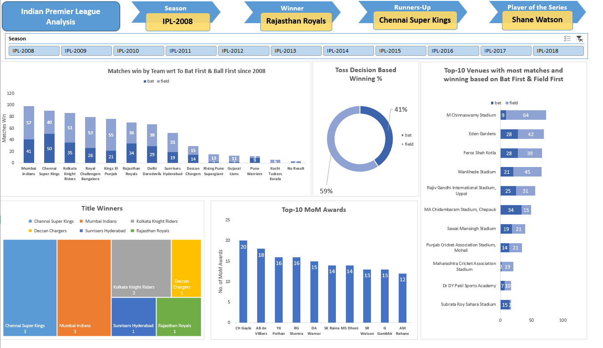
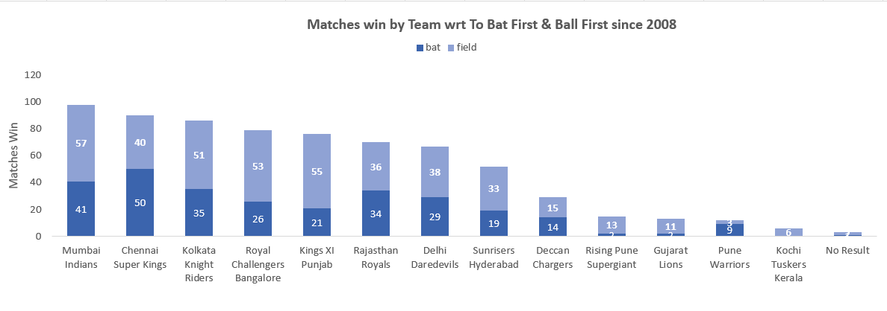
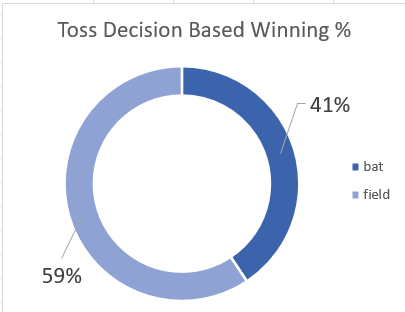
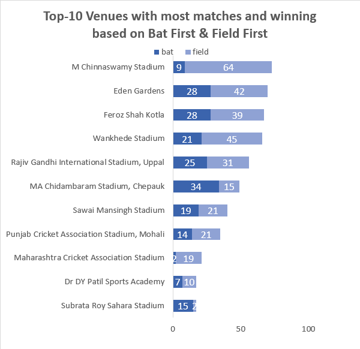
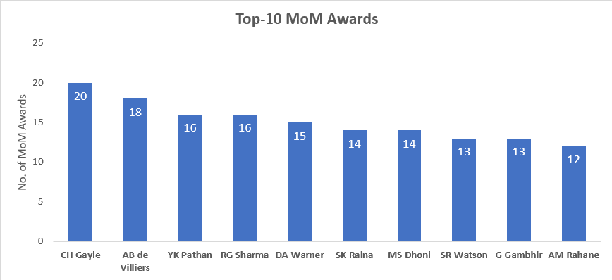
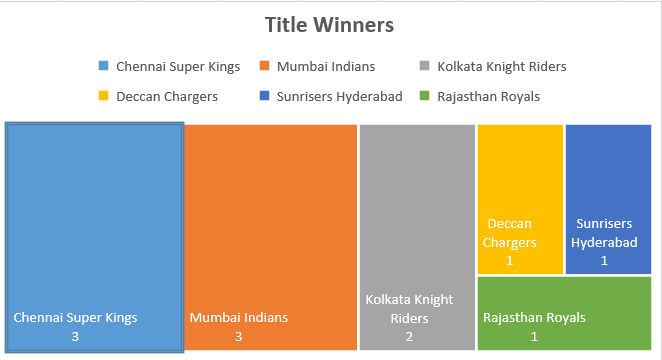

# 🏏 IPL Analysis Dashboard

An interactive Excel dashboard that analyses 11 seasons of the Indian Premier League (2008 to 2018). It answers one simple question: **what really drives wins in the IPL?**

## Dataset

- 📅 696 IPL matches played between **April 2008 and May 2018**.
- 🏟️ 13 teams, 35 venues and 32 cities.
- 🧾 Columns include season, date, city, venue, both teams, toss winner, toss decision, winner, player of the match, win margin and umpires.
- 🏆 A second small table holds the winner, runner-up, player of the match and player of the series for each season's final.
- 🔧 The `Season` column is built with a formula from the match date (for example `IPL-2018`).

## Questions Answered

- Which teams have won the most matches?
- Does choosing to bat or field after winning the toss matter?
- Which venues host the most matches, and do they favour batting first or fielding first?
- Which players win the most Man of the Match awards?
- Which teams have won the most IPL titles?
- Who won each season, who was runner-up and who was the player of the series?

## Dashboard Features

- 🎛️ **Season slicer:** pick any season from IPL-2008 to IPL-2018 and the season cards update.
- 🏆 **Season cards:** show the winner, runner-up and player of the series for the selected season.
- 📊 **Four charts and a treemap** that show the full picture on one page.
- 🔍 **XLOOKUP:** pulls the season details from the winners table.

## Analysis and Findings

### 1️⃣ Matches won by each team

- **Mumbai Indians** have the most wins (98), followed by **Chennai Super Kings** (90) and **Kolkata Knight Riders** (86).
- Wins are split by the toss decision of the match (bat or field).
- Most teams won more matches where the toss decision was to field. Chennai Super Kings are the exception (50 for bat vs 40 for field).

### 2️⃣ Toss decision

- Captains chose to **field first in 413 of 696 matches (59.3%)** and to bat first in 283 (40.7%).
- Fielding first is clearly the preferred choice.

### 3️⃣ Top venues

- **M Chinnaswamy Stadium** hosted the most matches (73), followed by Eden Gardens (70) and Feroz Shah Kotla (67).
- Chinnaswamy is very one-sided: 64 of its matches had a field-first decision against only 9 for bat first.
- **MA Chidambaram Stadium (Chepauk)** is the opposite: 34 bat-first matches against 15 field-first.
- The chart shows 11 venues because two venues are tied on 17 matches for the 10th place.

### 4️⃣ Man of the Match awards

- **CH Gayle** leads with 20 awards, then **AB de Villiers** (18), **RG Sharma** (16) and **YK Pathan** (16).
- DA Warner (15), MS Dhoni (14) and SK Raina (14) complete the top group.

### 5️⃣ Title winners

- **Chennai Super Kings** and **Mumbai Indians** have 3 titles each.
- Kolkata Knight Riders have 2.
- Deccan Chargers, Sunrisers Hyderabad and Rajasthan Royals have 1 each.
- 6 different teams won the 11 seasons, so the title has been shared widely.

## Workbook Structure

- 📄 `IPL-Data`: raw match data (Excel Table)
- 📄 `Winner Data`: season winners, runners-up and award winners
- 📄 `Matches Win`: pivot table and chart of wins by team and toss decision
- 📄 `Toss Based Decision`: pivot table and chart of bat vs field share
- 📄 `Top-10 Venues`: pivot table and chart of top venues
- 📄 `MoM Awards`: pivot table and chart of top players
- 📄 `Title Winner`: pivot table and treemap of titles
- 📄 `Pre-Dashboard`: season slicer and lookup formulas
- 📄 `Dashboard`: the final one-page dashboard

## Limitations

- The data stops at the 2018 season, so it does not cover later years or teams such as Gujarat Titans and Lucknow Super Giants.
- The bat/field split shows the **toss decision of the match**. It does not show whether the winning team itself batted first.
- 3 matches ended with no result and are shown as "No Result" in the wins chart.
- Wins alone do not show team strength. Teams that played more seasons (like Mumbai and Chennai) naturally have more wins.

## How to Use

1. Open [Project-3.xlsx](Project-3.xlsx) in Excel (Excel 365 or 2021 is needed for XLOOKUP and the treemap chart).
2. Go to the `Dashboard` sheet.
3. Click a season in the slicer to see its winner, runner-up and player of the series.

## Skills Used

- **📊 Pivot Tables and Pivot Charts**
- **🎛️ Slicers**
- **🔍 XLOOKUP and GETPIVOTDATA**
- **🗂️ Excel Tables**
- **🧮 Formulas and Functions** (TEXT, date handling)
- **🌳 Treemap and Doughnut Charts**
- **🖥️ Dashboard Design**

## Files

- 📗 **Workbook:** [Project-3.xlsx](Project-3.xlsx)
- 🖼️ **Images:** stored in the `Images/` folder of this repository
