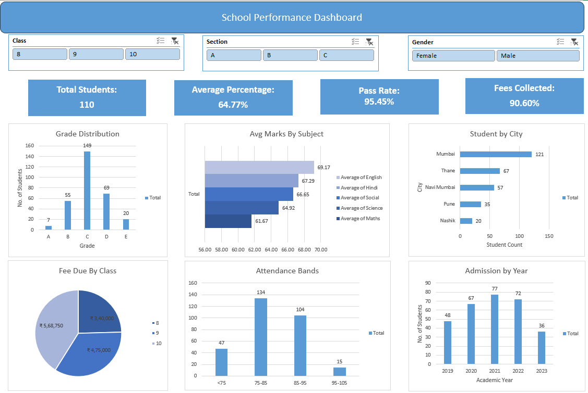
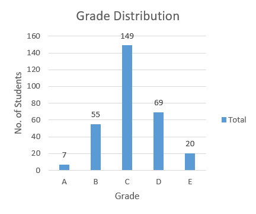
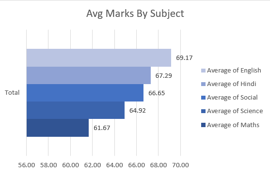
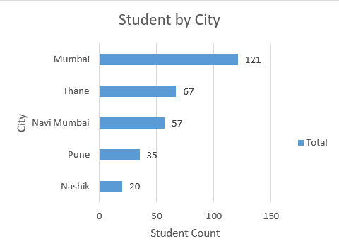
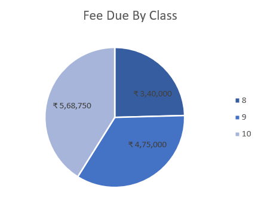
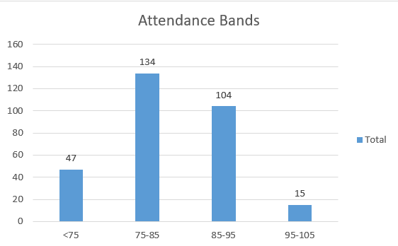
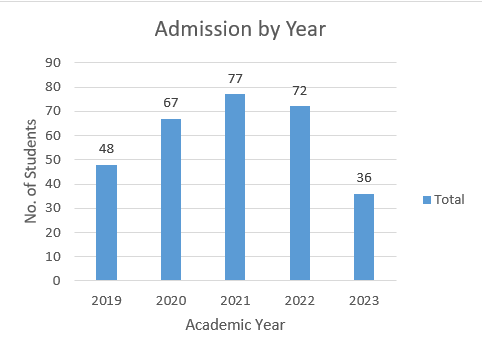

# 🎓 Project 4: School Performance Dashboard

An interactive Excel dashboard that shows how 300 students in Classes 8 to 10 are doing. It covers marks, attendance, fees, cities and admissions, and every number updates when you click a slicer for Class, Section or Gender.

## ❓ Questions the Dashboard Answers

- How many students are there, and how are they doing overall?
- What share of students pass, and how are grades spread?
- Which subjects are strongest and weakest?
- Does attendance affect marks?
- How much fee has been collected, and which class owes the most?
- Where do students come from, and how has admission changed by year?

## 🗂️ Dataset

- 🧪 A **synthetic (generated) practice dataset**, created for learning. It is not real student data.
- 👩‍🎓 300 students across Classes 8, 9 and 10, Sections A, B and C, from 5 cities (Mumbai, Thane, Navi Mumbai, Pune, Nashik).
- 🧾 17 columns: student ID, name, gender, class, section, city, admission date, attendance %, marks in 5 subjects (Maths, Science, English, Hindi, Social), fee total, fee paid, extracurricular activity and transport.
- 🕳️ 10 marks are left blank on purpose, to show absence. This makes the formulas handle missing data.

## 🔎 Key Findings

Numbers below are for all 300 students (no slicers selected).

- ✅ **94.3% of students pass** (283 of 300). 7 fail and 10 have an incomplete result because they missed an exam.
- 📘 **Maths is the weakest subject (61.7 on average) and English is the strongest (69.2).**
- 📉 **Attendance is strongly linked to marks.** The 47 students below 75% attendance average about 51%, against about 68% for everyone else. The correlation between attendance and percentage is 0.74.
- 💰 **90.8% of fees are collected.** ₹13,83,750 is still due from 86 students, and **Class 10 holds the largest part (₹5,68,750, about 41%).**
- 🏙️ **Mumbai has 121 students (40% of the school)**, well ahead of Thane (67) and Navi Mumbai (57).
- 🎨 **Extracurricular activities make little difference.** Sports students average 66.1% against 64.8% for students with no activity, a gap of about 1.3 points.
- 🚌 **School bus users have slightly better attendance** (83.7% against 82.4% for students with no transport).

> These findings describe patterns in a generated dataset. They show how to read a dashboard, not facts about real schools.

## 📊 The Six Charts

### 1. Grade Distribution
Number of students in each grade. Most students fall in grade C (149), followed by D (69) and B (55). Only 7 reach grade A.

### 2. Avg Marks By Subject
Average mark in each of the five subjects. The spread is narrow, from 61.7 in Maths to 69.2 in English.

### 3. Student by City
Student count per city, sorted high to low. Mumbai leads with 121, followed by Thane (67), Navi Mumbai (57), Pune (35) and Nashik (20).

### 4. Fee Due By Class
Share of the pending fee by class. Class 10 owes ₹5,68,750, Class 9 owes ₹4,75,000 and Class 8 owes ₹3,40,000.

### 5. Attendance Bands
Students grouped by attendance: below 75% (47), 75 to 85% (134), 85 to 95% (104) and 95% and above (15).

### 6. Admission by Year
Students by year of admission. Admissions grew from 48 in 2019 to a peak of 77 in 2021, then fell to 36 in 2023.

## ⚙️ How the Dashboard Is Built

1. **Clean table:** The data sits in an Excel table named `student`, with helper columns for Total, Percentage, Grade, Result, Fee Due, Admission Year and Pass Flag.
2. **Pivot tables:** One pivot table feeds each chart (sheet `Pre-Dashboard`), and a small KPI pivot feeds the four cards (sheet `KPI_Calc`).
3. **Slicers:** Class, Section and Gender slicers are connected to every pivot table through Report Connections, so all charts and cards change together.
4. **KPI cards:** Each card is a shape linked to a cell that pulls its value from the KPI pivot with `GETPIVOTDATA`, so the cards react to the slicers too.
5. **Dashboard sheet:** The charts, slicers and cards are arranged on one page with gridlines hidden.

## 📐 Calculation Choices

- **Percentage** = total marks ÷ 500, so a missed exam counts as zero.
- **Grade:** A is 90% and above, B 75%, C 60%, D 45%, and E is below 45%.
- **Result:** Pass means 33 or more in all five subjects. Fail means below 33 in any subject. Incomplete means at least one exam is blank.
- **Pass rate** = students with result Pass ÷ all students.

## ✏️ Practice Questions Before the Dashboard

Before building the dashboard, I solved **27 practice questions** on the same data, so the dashboard is built on numbers I had already checked. I used formulas where possible and pivot tables where they were faster.

| Topic | Questions | Skills used |
|---|---|---|
| Helper columns | Q1 to Q6 | `SUM`, `AVERAGE`, `IFS`, `IF`, `COUNT`, `MIN`, `YEAR` |
| Counting | Q7 to Q10 | `COUNTIFS`, pivot tables |
| Averages | Q11 to Q14 | `AVERAGEIFS`, pivot tables |
| Lookups | Q15 to Q17 | `XLOOKUP`, `MAXIFS`, `LARGE`, `ROWS` |
| Attendance and fees | Q18 to Q22 | `COUNTIFS`, `AVERAGEIFS`, `CORREL`, `SUMIFS`, pivot tables |
| Activities and transport | Q23 to Q24 | Pivot tables |
| Challenge | Q25 to Q27 | `COUNTIFS`, pass-rate formulas, `FILTER` |

Each topic has its own sheet in the workbook (`Analysis Questions`, `Averages`, `LookUps`, `Attendance & Fees`, `Activities & Transport`, `Challenging`).

## 🛠️ Skills Used

- 📊 PivotTables and PivotCharts
- 🎛️ Slicers connected to multiple pivots
- 🔍 XLOOKUP, MAXIFS, LARGE, FILTER
- 🧮 COUNTIFS, AVERAGEIFS, SUMIFS, IFS, CORREL
- 🔗 GETPIVOTDATA and cards linked to cells
- 📐 Excel tables with structured references
- 🎨 Dashboard layout and formatting

## 📁 Files

- 📗 **Workbook:** [Project-4.xlsx](Project-4.xlsx)
- 🗂️ **Dataset:** [School_Student_Data.xlsx](School_Student_Data.xlsx)

## 🔙 Back to Main

[Excel Data Analytics](../README.md)
