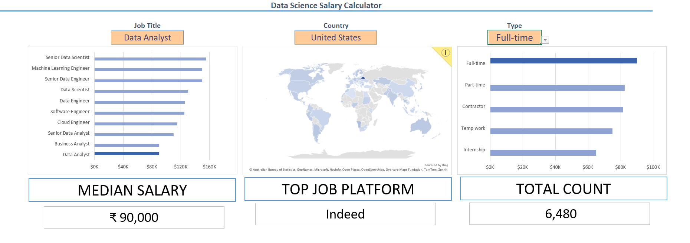
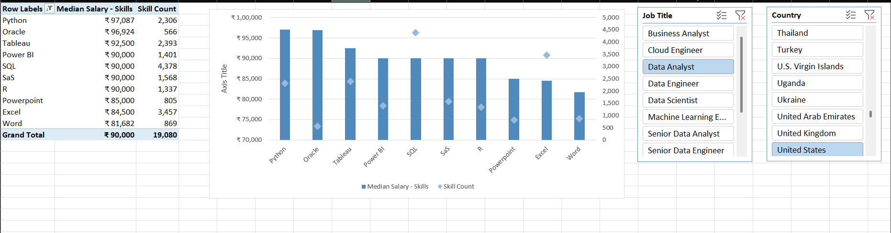

# Excel Data Analytics

Two Excel projects built on the same data jobs dataset. The goal: help job seekers see what data jobs pay and which skills matter.

## Dataset

- 📅 Real-world data science job postings from 2023.
- 📚 Taken from an Excel course I followed.
- 🧾 Includes job titles, salaries, locations and skills.

## Projects

### 1️⃣ [Excel Salary Dashboard](Project-1/README.md)

An interactive dashboard to look up median salaries by job title, country and schedule type.

- 🛠️ **Skills:** Charts, Formulas and Functions, Data Validation
- 📗 **Workbook:** [Project-1.xlsx](Project-1/Project-1.xlsx)
- 👉 **Full write-up:** [Project-1/README.md](Project-1/README.md)

### 2️⃣ [Data Jobs Market Analysis](Project-2/README.md)

An analysis of skills, pay and regions in the data job market. It answers four questions:

- Do more skills get you better pay?
- What is the salary for data jobs in different regions?
- What are the top skills of data professionals?
- What is the pay for the top 10 skills?

- 🛠️ **Skills:** Power Query, Power Pivot, PivotTables, PivotCharts, DAX
- 👉 **Full write-up:** [Project-2/README.md](Project-2/README.md)

## Repository Structure

- 📁 `Images/`: screenshots and charts used in the project READMEs
- 📁 `Project-1/`: salary dashboard (workbook and README)
- 📁 `Project-2/`: market analysis (README)

## Tools Used

- **📉 Charts**
- **🧮 Formulas and Functions**
- **❎ Data Validation**
- **📊 Pivot Tables and Pivot Charts**
- **🧮 DAX**
- **🔍 Power Query**
- **💪 Power Pivot**
